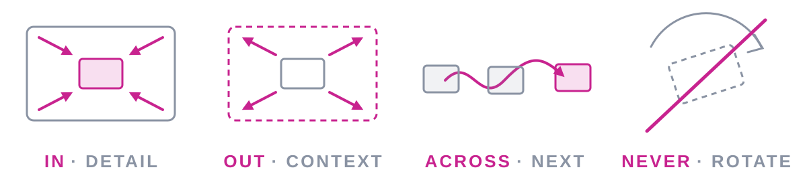

# Kitchen sink
Every kind of content a stop can hold, for checking that the page and the estimates agree.

## Quotes are set apart {#quotes}
> The map is not the territory, but a good map makes the territory walkable.

A line after the quote.

### Two quoted paragraphs
> First paragraph of a longer quote, which runs on for a while.
>
> Second paragraph.

## Tables line up {#tables}
| Stage | Time | Owner |
|---|---|---|
| Intake | 2 days | Ops |
| Triage | 1 day | Leads |
| Build | 5 days | Team |

### Numbered steps
1. Write the deck
2. Run the checker
3. Fix what it finds

### Nested points
- A point
  - with detail under it
  - and more detail
- Another point

## Rules divide {#rules}
Above the rule.

---

Below the rule. See [[tables]] and [[quotes|the quotes]].

## Technical detail {#technical .detour density=technical}
The technical density sets smaller text, so a detour for the few who want it can hold more. This paragraph runs long on purpose, to show how much more fits: a hundred words or so of explanation that would crowd a talk stop, but reads comfortably here, where the people who asked are leaning in. It goes on to mention `inline code`, **bold phrases** and *emphasis*, which change the width of the words around them.

```ts
export function route(deck: Deck): Target[] {
  const onRoute = deck.stops.filter(s => !s.detour);
  return onRoute.map(s => ({ kind: "stop", id: s.id }));
}
```

## Pictures sit beside or below {#pictures}
A wide figure spans the card below the text.

{.wide}

### Missing media shows a placeholder

